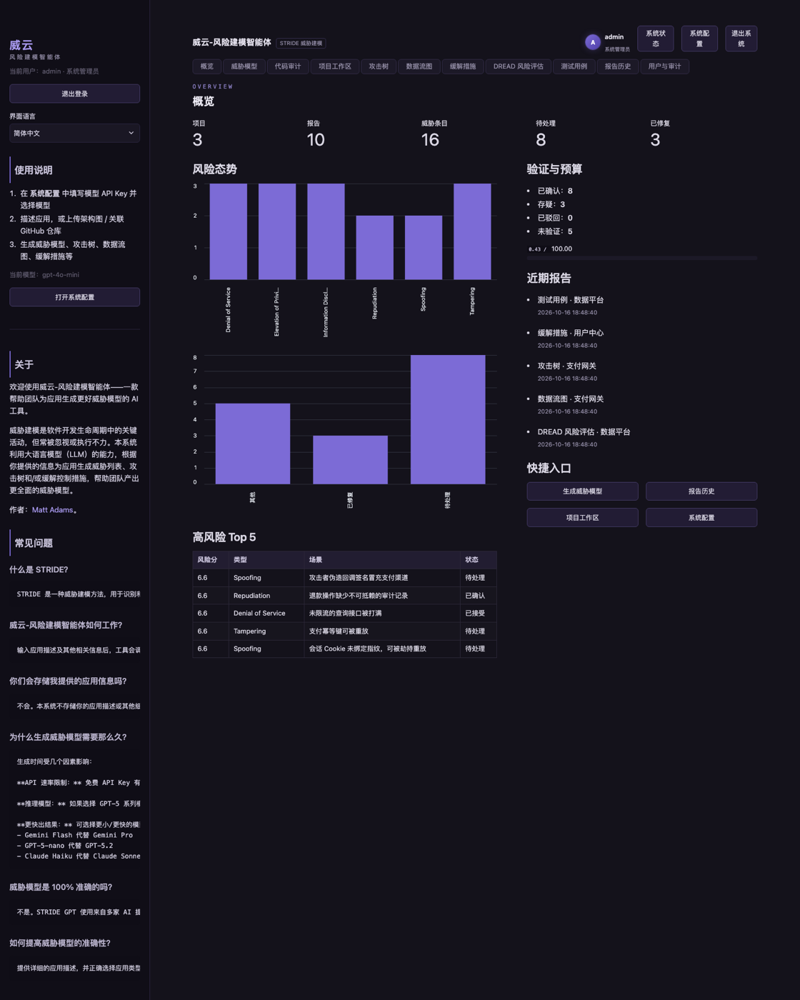
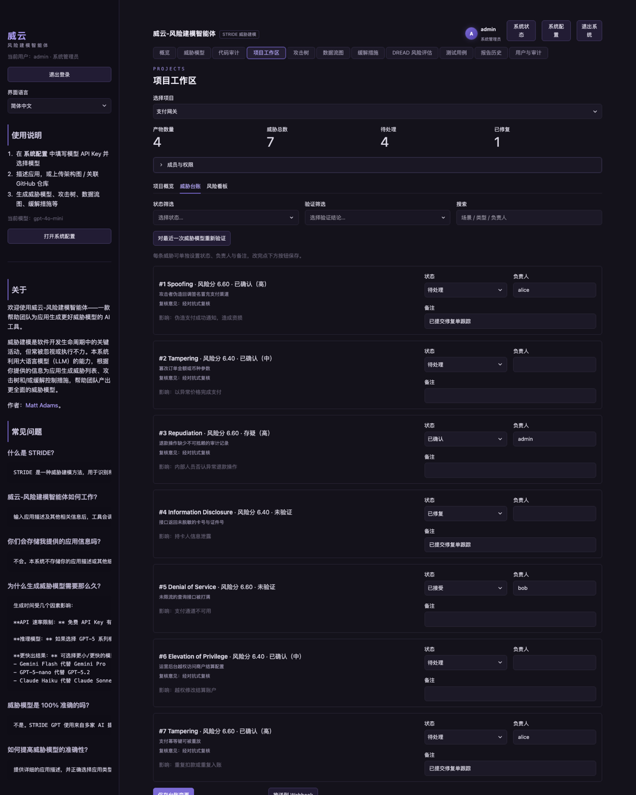
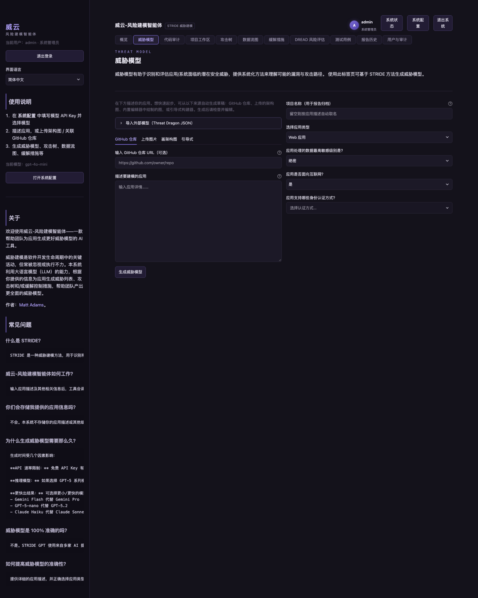
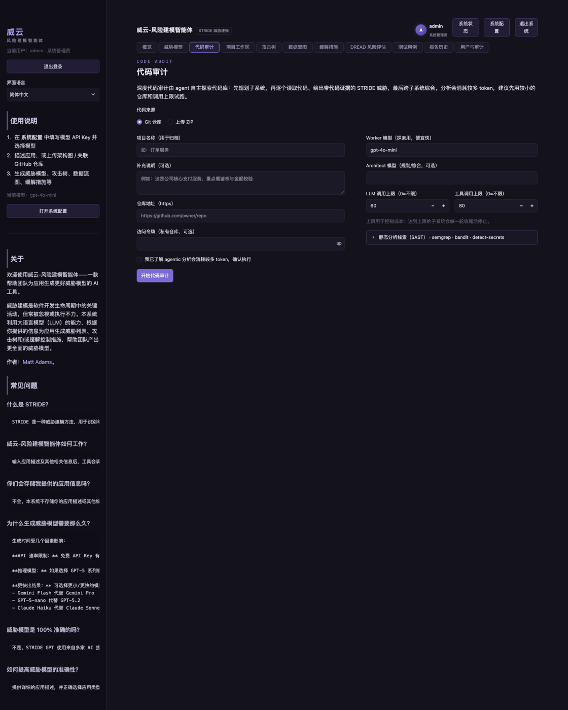
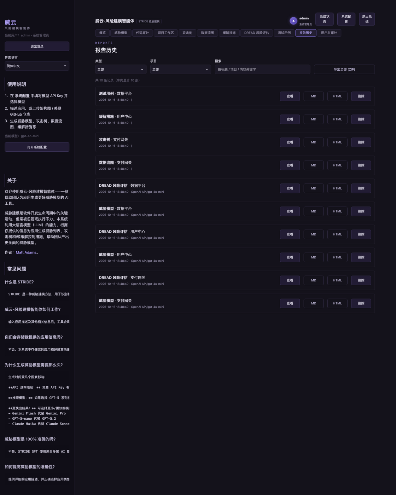
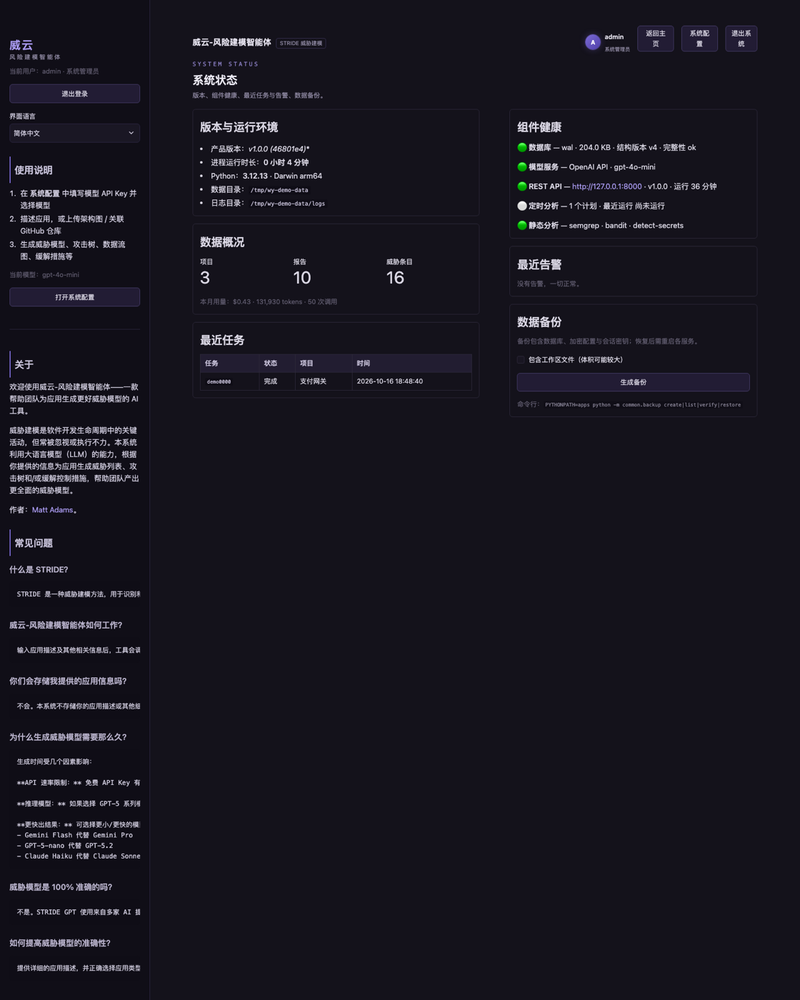
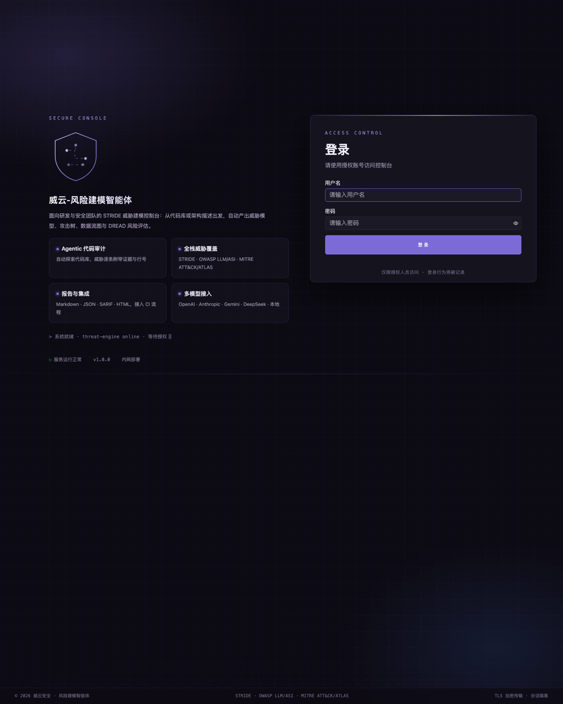
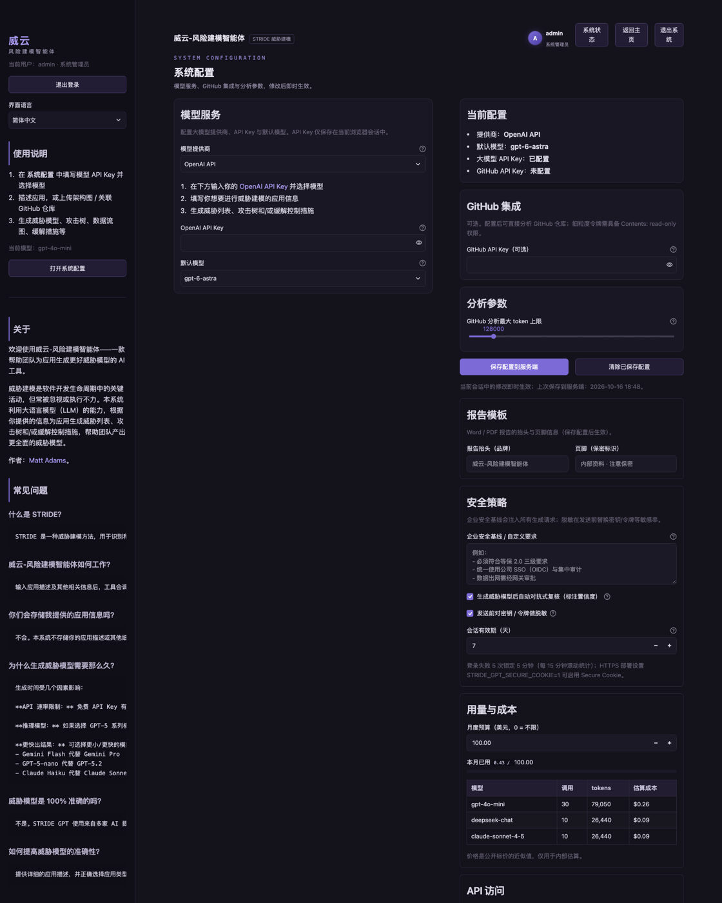

# 威云-风险建模智能体

[](https://github.com/3111365696/weiyun-risk-modeling-agent/actions/workflows/ci.yml)


> 面向研发与安全团队的 STRIDE 威胁建模与代码审计平台。从代码库或架构描述出发，
> 自动产出威胁模型、攻击树、数据流图、缓解措施与 DREAD 风险评估，并提供台账、复核、
> 报告导出与 REST API，全流程可审计、可备份、可交付。

本仓库是开源项目 [stride-gpt](https://github.com/msoedov/stride-gpt) 的中文本地化发行版，
在保留其 CLI 能力的基础上扩展为可部署的内部系统。

## 界面预览

<table>
  <tr>
    <td width="50%"><br><sub><b>概览</b>：风险态势、验证统计、近期报告与用量</sub></td>
    <td width="50%"><br><sub><b>项目工作区</b>：威胁台账、状态/负责人/复核结论、定时计划与成员</sub></td>
  </tr>
  <tr>
    <td><br><sub><b>威胁模型</b>：从描述、架构图、仓库或引导式问答生成</sub></td>
    <td><br><sub><b>代码审计</b>：Agentic 代码库分析 + 静态分析（SAST）线索</sub></td>
  </tr>
  <tr>
    <td><br><sub><b>报告历史</b>：Markdown/HTML/JSON/SARIF/Word/PDF/STIX 导出</sub></td>
    <td><br><sub><b>系统状态</b>：版本、组件健康、任务与告警、一键备份</sub></td>
  </tr>
</table>

<details>
<summary>更多截图（登录页 / 系统配置）</summary>

<table>
  <tr>
    <td width="50%"><br><sub><b>登录</b>：会话隔离、失败锁定、审计留痕</sub></td>
    <td width="50%"><br><sub><b>系统配置</b>：模型服务、安全策略、API Key、配额</sub></td>
  </tr>
</table>
</details>

> 截图为演示数据（独立数据目录，与真实数据隔离）。

## 功能

| 领域 | 能力 |
|---|---|
| 威胁建模 | STRIDE 六类威胁、数据流图（Mermaid）、攻击树、缓解措施、DREAD 评分、Gherkin 测试用例 |
| 代码审计 | ZIP / Git 仓库 → agent 自动探索代码 → 带 `文件:行` 证据的威胁入库；可导出 SARIF 接入 CI |
| 静态分析 | Semgrep（内置离线规则包）/ Bandit / detect-secrets；gitleaks / trivy 探测式启用，缺失自动降级 |
| 治理 | 威胁台账（状态/负责人/备注/证据）、对抗式复核（已确认/存疑/已驳回+置信度）、风险看板、项目成员（owner/editor/viewer） |
| 报告 | Markdown / HTML / JSON / SARIF / Word / PDF / ZIP；STIX 2.1；Threat Dragon 双向互通；自动关联 CWE |
| 自动化 | 一键全流程、定时分析（常驻调度器或 cron）、Webhook 推送（飞书/企微/钉钉/通用） |
| 平台 | 多用户与角色、审计日志、API Key（作用域/有效期/轮换/配额）、用量与预算、中英双语 |
| 运维 | 结构化日志、页面错误边界（错误编号）、数据库 WAL、备份/恢复、系统状态页、健康检查 |

## 快速开始

### 方式一：裸机（最快）

```bash
# 需要 Python 3.12+
git clone <内部仓库> wy && cd wy
scripts/install.sh                       # 检查环境 → 安装依赖 → 初始化数据目录
cp .env.example .env && vi .env          # 至少设置 STRIDE_GPT_PASSWORD 与模型 API Key
scripts/run_web.sh                       # http://localhost:8501
```

首次登录后：**系统配置 → 模型服务** 填写 API Key（也可只用 `.env` 中的环境变量），
然后到「威胁模型」页按引导生成第一份模型。

### 方式二：容器（含 API 与调度器）

```bash
cp .env.example .env                     # 设置 STRIDE_GPT_PASSWORD
docker compose up -d --build
# Web http://localhost:8501 ｜ API http://localhost:8000/docs
```

### 方式三：systemd（生产）

见 [运维手册](docs/ops-guide.md#2-安装)，单元文件在 `deploy/systemd/`。

### CLI（沿用上游能力）

```bash
uv run stride-gpt --help                 # 交互式威胁建模（终端）
uv run python -m apps.scheduler.main --once   # 手动跑一轮到期计划
```

## 文档

- [用户手册](docs/user-guide.md) —— 建模流程、代码审计、台账、报告与常见问题
- [管理员手册](docs/admin-guide.md) —— 用户与权限、系统配置、API Key、备份、审计
- [运维手册](docs/ops-guide.md) —— 安装/升级、日志排障、健康检查、安全加固、故障处理
- [REST API](docs/api.md) —— 端点、鉴权、示例（curl）
- [自动化](docs/automation.md) —— 定时分析、Webhook、CI 集成
- [更新日志](CHANGELOG.md) —— 版本与结构迁移记录

## 架构

```
Web(Streamlit :8501) ─┐
API(FastAPI  :8000)  ─┼─ 共享数据目录（默认 ~/.stride-gpt，可用 STRIDE_GPT_DATA_DIR）
Scheduler            ─┘   ├── web.db（SQLite/WAL）  ├── web_config.json（加密）
                          ├── logs/*.jsonl           ├── backups/*.zip
                          └── workspaces/（审计工作区，临时）
```

- 代码结构：`stride_gpt/`（核心建模能力，CLI/SDK 共用）、`apps/common/`（存储/生成/导出/
  日志/备份/权限等公共层）、`apps/web/`（界面：`shared/widgets/services/pages`）、
  `apps/api/`（REST API）、`apps/scheduler/`（定时分析）。
- 数据库结构版本由 `schema_migrations` 表管理（`scripts/upgrade.sh` 会输出）。

## 数据与安全

- 所有数据本地落地，不依赖外部数据库；配置加密存储（Fernet，密钥文件 0600）。
- 密码策略、登录失败锁定、会话有效期、退出所有设备、强制下线；API Key 作用域与轮换。
- 企业安全基线注入 + 发送前敏感信息脱敏；报告可带保密标识。
- 备份：`scripts/backup.sh`，恢复：`scripts/restore.sh`（恢复前自动备份当前状态）。
- HTTPS 部署请设置 `STRIDE_GPT_SECURE_COOKIE=1` 并用反向代理终结 TLS。

## 质量

```bash
uv run pytest -q                 # 1000+ 测试（含端到端流程与性能冒烟）
uv run ruff check apps tests     # 静态检查
PYTHONPATH=apps uv run python scripts/bench.py   # 性能基准
```

## 目录结构（节选）

```
apps/
  common/      # store(数据) / generation(生成) / scanners(SAST) / standards(CWE/STIX)
               # backup(备份) / logging_setup(日志) / version / usage / scrub …
  web/         # main.py(装配) + shared/widgets/services/auth/theme + pages/*(13 个页面)
  api/         # FastAPI：生成、项目、台账、任务、定时计划、导出
  scheduler/   # 定时分析常驻进程
stride_gpt/    # 核心：agent 引擎、prompts、dfd/dread/mitigations/test_cases、CLI
deploy/        # systemd 单元与环境变量样例
docs/          # 用户/管理员/运维/API/自动化文档
scripts/       # 安装、升级、运行、备份、恢复、基准
tests/         # 单元 + 集成 + 端到端 + 性能/门禁测试
```

## 与上游的关系

- 核心建模与 CLI 能力来自 [stride-gpt](https://github.com/msoedov/stride-gpt)（MIT）。
- 本发行版新增/改造：中文化与双语界面、登录与多用户、项目治理与台账、代码审计工作台、
  静态分析接入、标准导出（SARIF/STIX/Threat Dragon）、REST API、调度器、备份与日志、
  安全与权限、部署与文档体系。
- 未改动上游许可证；二次分发请保留 LICENSE 与上游致谢。

## 许可

MIT，详见 [LICENSE](LICENSE)。
